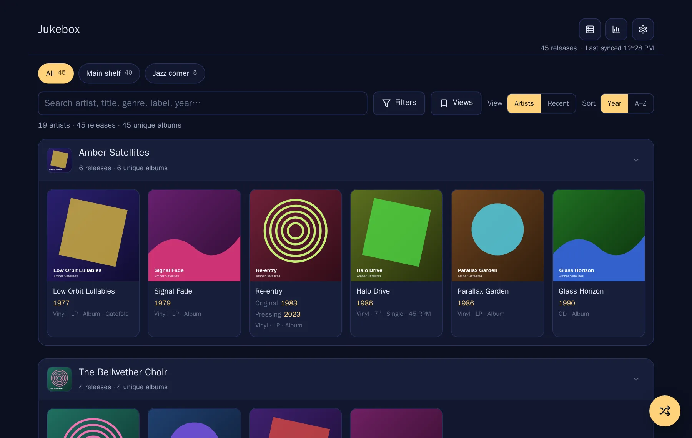
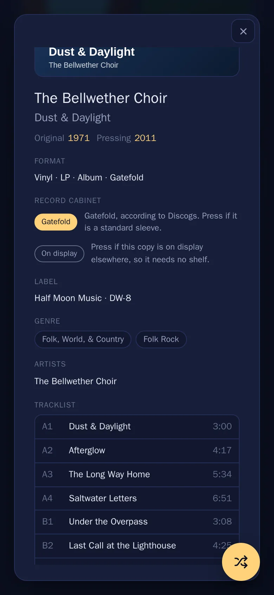
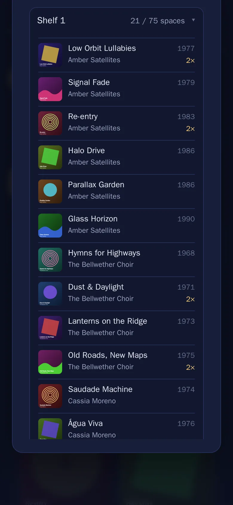
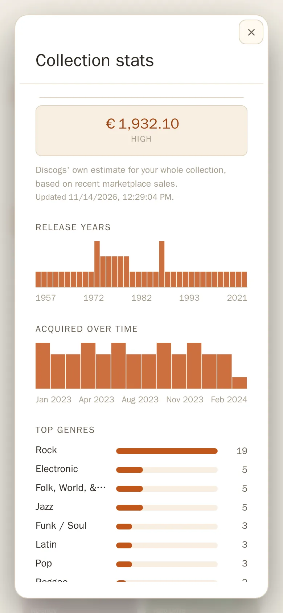
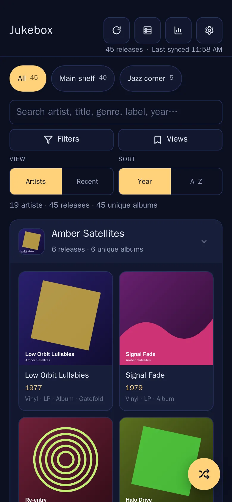
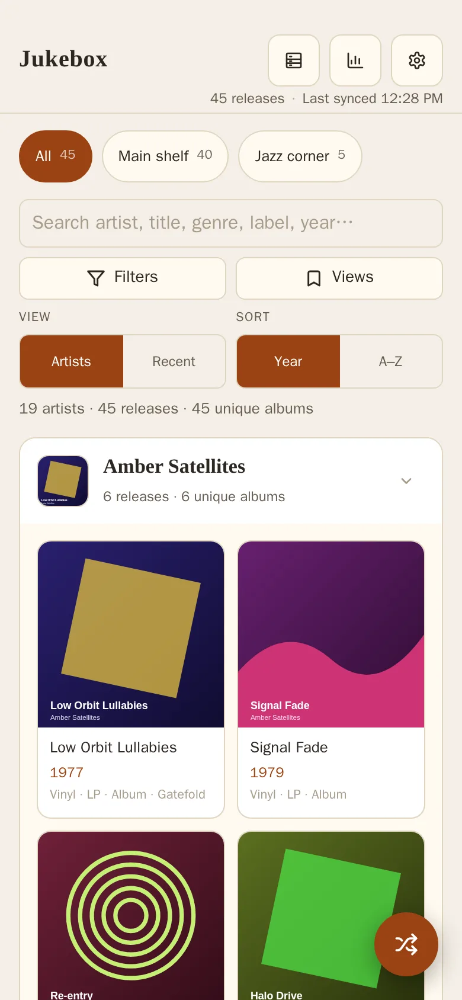
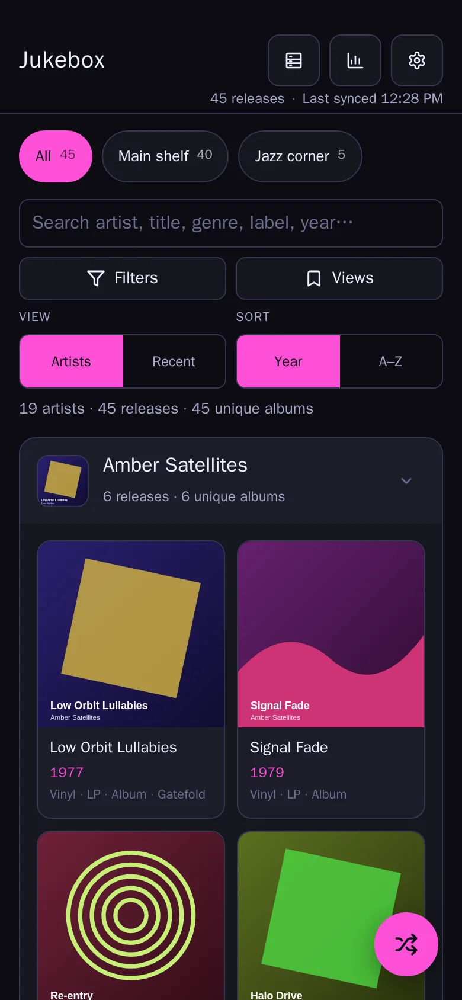
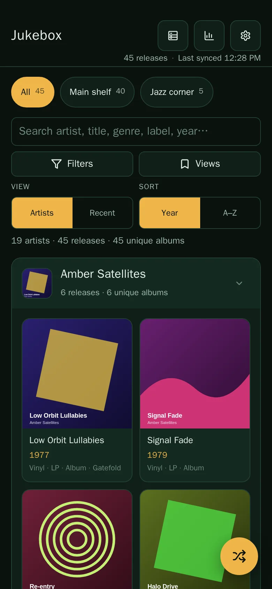

<p align="center">
  
</p>

<h1 align="center">Jukebox</h1>

<p align="center">
  <strong>Your Discogs record collection, beautifully browsable.</strong><br>
  A fast, installable web app for your vinyl: grouped by artist, searchable, offline, and self-hosted.
</p>

<p align="center">
  <a href="https://github.com/ackervekenbm/jukebox/actions/workflows/ci.yml"></a>
  <a href="https://github.com/ackervekenbm/jukebox/actions/workflows/docker-build.yml"></a>
  <a href="https://github.com/ackervekenbm/jukebox/actions/workflows/discogs-contract.yml"></a>
  <a href="LICENSE"></a>
  <a href="https://github.com/ackervekenbm/jukebox/pkgs/container/jukebox"></a>
</p>

<p align="center">
  
</p>

Jukebox turns your [Discogs](https://www.discogs.com) collection into a cover-art library you'll actually
want to browse. It runs in your browser, works on your phone like a native app, and keeps your
collection on your device. A small server you host yourself handles the Discogs connection and
syncs your record cabinet across devices.

*Every screenshot shows an invented demo collection: the artists, albums and covers are made up.*

## Highlights

- 🎛️ **Browse by artist or by date added.** Artists are filed the way a record shop does it ("The Menzingers" under *M*), and each artist's records are ordered by original release year or A–Z. Switch to the *Recent* timeline to see what you added each month.
- 🔎 **Search, filters, saved views and folders.** Search by artist, title, genre, style, label or year, or filter by format, genre, style, label and year range. Save a search as a view such as "7-inch singles" or "90s techno", and open your Discogs folders from the bar at the top.
- 🗄️ **Record cabinet planner.** Tell it your shelves and it files your collection onto them. Double LPs and gatefold sleeves count as two spaces, and 12" and 7" records can get shelves of their own. It warns when the shelves run out of room.
- 🎲 **Can't decide? Shuffle.** The random picker chooses from what's on screen and skips the records it picked recently.
- 📀 **Every detail.** Original and pressing year, label and catalogue number, credits, tracklists and Discogs' estimate of what your collection is worth.
- 📱 **Installable and offline.** Add it to your home screen. After the first fetch, your collection opens instantly, even without a connection.
- 🎨 **Four themes:** Midnight, Paper, Club and Forest.
- 🔒 **Private by design.** No accounts and no tracking. Your token and collection stay in your browser, and your server runs on your own network.

<table>
  <tr>
    <td align="center"><br><sub>Release details and tracklists</sub></td>
    <td align="center"><br><sub>The record cabinet, shelf by shelf</sub></td>
    <td align="center"><br><sub>Collection stats and value</sub></td>
  </tr>
</table>

<table>
  <tr>
    <td align="center"><br><sub>Midnight</sub></td>
    <td align="center"><br><sub>Paper</sub></td>
    <td align="center"><br><sub>Club</sub></td>
    <td align="center"><br><sub>Forest</sub></td>
  </tr>
</table>

## Quick start

You need **Docker** and a free **Discogs personal access token** ([create one here](https://www.discogs.com/settings/developers)).

```bash
docker run -d --name jukebox -p 8080:3000 -v jukebox-data:/app/data \
  --log-driver json-file --log-opt max-size=10m --log-opt max-file=3 \
  --restart unless-stopped ghcr.io/ackervekenbm/jukebox:latest
```

Open <http://localhost:8080>, enter your Discogs username and token, and your collection loads.
The image is public and built for `amd64` and `arm64`, so it needs a 64-bit OS; a Raspberry Pi works too.
For other setups (Compose, bare Node, OpenMediaVault, HTTPS) see [Deployment](#deployment).

### Try it without a Discogs account

```bash
git clone https://github.com/ackervekenbm/jukebox && cd jukebox
npm install
npm run demo
```

Open <http://localhost:5199> and sign in as **`demo`** with any token. A local stand-in for the
Discogs API ([`scripts/demo-discogs.mjs`](scripts/demo-discogs.mjs)) serves the invented collection
from the screenshots, so nothing goes over the network. The demo commands assume a macOS or Linux shell.

## Features in detail

<details>
<summary><strong>Browsing: artists, filing order, pressings, Recent view</strong></summary>

- **Grouped by artist.** Split and collaboration releases appear under every credited artist, while compilations stay under **Various**. Discogs' disambiguation suffixes are dropped, so **Alice Cooper (2)** groups and searches under **Alice Cooper**.
- **Filing order.** Leading articles (`a`, `an`, `the`) are ignored when sorting, so **The Menzingers** files under **M**. Accents and punctuation are normalised too (`Motörhead` → `motorhead`).
- **Within an artist**, sort by **Year** (oldest to newest by *original* release year; undated records last) or **A–Z**. Click an artist header to collapse its row.
- **Group pressings by master** (optional, off by default). All pressings of the same Discogs master share one card marked `3 pressings` (or `3 copies` for duplicates). Open it and step through them with ‹ / › or the arrow keys.
- **Recent view.** A month-by-month timeline of what you added, newest first, in your local time. Search and filters still apply, and records without a usable date go into an **Undated** section. It reads dates the collection already has, so it makes no extra API calls.
- **Running totals:** `N artists · M releases · U unique albums`, where *unique albums* counts distinct masters.

</details>

<details>
<summary><strong>Finding things: search, filters, saved views, folders</strong></summary>

- **Search** covers artist, title, genre, style, label and year. **Filters** for format, genre, style, label and year range only offer values from your own collection.
- **Saved views** store a search and its filters under a name, so one tap brings them back. Each view shows how many records it matches right now. Change the search or filters and the view is marked as changed, with one-tap **update** or **revert**.
- **Folders.** Pick a Discogs folder (or **All**) and the search, filters, totals and grid follow it. The whole collection is fetched once, so switching folders is instant.
- When nothing matches, one tap clears the search and filters.

</details>

<details>
<summary><strong>The record cabinet</strong></summary>

The cabinet icon opens a planner for your physical shelves. Add shelves, set how many records each holds (1–500), and the app lays out your collection automatically:

- Shelves follow the main view's order: artists by filing name, and within each artist the same **Year** or **A–Z** order.
- **Shelf space is counted realistically.** A double LP takes two spaces, and so does a gatefold sleeve. Gatefolds are found in the format details, or in the release notes, which are checked once in the background while the cabinet is open. The check understands English, German, French, Italian, Spanish, Dutch and Japanese. Records that take two spaces are marked `2×`.
- **Tap a record** to open its details. There you can correct the gatefold call, or mark a copy as **on display** elsewhere so it doesn't need a shelf.
- **Separate sizes** (optional) keeps 12" records and 7"/10" singles on shelves of their own. CDs and tapes form their own group.
- **Warnings** appear when sizes have to share a shelf, an artist is split across shelves, records are out of order because shelves are nearly full, a shelf is over capacity, or records fit nowhere.
- **Edit shelves** to change sizes or remove a shelf. **Undo** brings a removed shelf back.
- The cabinet **syncs across your devices** through your Jukebox server.

</details>

<details>
<summary><strong>Details, tracklists, stats and the random picker</strong></summary>

- **Release details:** original and pressing years, format, label and catalogue number, genres and styles, credits, country, rating, date added, and links to the release and master on Discogs.
- **Tracklists** load when you open a release and are cached in the browser, so they work offline after that.
- **Collection stats:** release years, how the collection grew over time, top genres, and Discogs' low / median / high estimate of its value.
- **Random picker.** The shuffle button picks from what's on screen and respects your search and filters. Each pick goes into a local **listen log** (the last 200), and the picker skips your most recent picks: 10 by default, adjustable from 0 to 100. Opened from the picker, the detail view lists your last few picks so you can go back to one.

</details>

<details>
<summary><strong>How it talks to Discogs</strong></summary>

1. **Fetch.** Your collection is read from the Discogs API page by page, staying well inside Discogs' 60-requests-per-minute limit. If Discogs asks it to slow down, it backs off and retries.
2. **Cache.** Everything is stored in your browser, so the next visit opens instantly and quietly checks Discogs for changes.
3. **Enrich.** Original release years are looked up from each album's Discogs master in the background and appear as they arrive.
4. **On demand.** Tracklists are fetched when you open a release.

All calls go through a same-origin `/discogs` proxy on your Jukebox server. Discogs' rate-limit responses carry no CORS headers, so without the proxy the browser would hide a "slow down" as an opaque CORS error.
A [nightly check](.github/workflows/discogs-contract.yml) replays real Discogs responses through the app's parsers, so changes to the Discogs API show up before you hit them.

</details>

## Where your data lives

- **Your token** is stored in your browser (localStorage). Discogs requests go through your own Jukebox server, which forwards the token to Discogs. The server never stores or logs it, and keeps only a hash for ten minutes to check sync requests. Cover art loads straight from Discogs, without the token. Over plain HTTP the token crosses your network unencrypted, so [use HTTPS](docs/deploy/https-and-offline.md) on a network you don't trust. You can regenerate the token at any time on [Discogs](https://www.discogs.com/settings/developers).
- **Your collection, tracklists, original years, release notes and listen log** are stored in your browser (IndexedDB). Saved views, the picker setting and your settings are in localStorage. Your browser's copy is the source of truth.
- **The server keeps a small SQLite database** for cross-device sync of the record cabinet, keyed by your Discogs username ([#55](https://github.com/ackervekenbm/jukebox/issues/55)). It holds your shelves and their sizes, the layout options, your gatefold corrections (Discogs release ids) and the copies marked on display (collection instance ids). Each device works out the shelf layout itself. Titles, artists, covers and tracklists stay in your browser.
- **"Clear everything"** in settings removes the cached collection, saved views, listen log, picker setting, cabinet and stored credentials from that device.

## Deployment

Jukebox is **one Node process**. It serves the app, the `/api` sync store and the `/discogs` proxy, and runs anywhere Node 22+ or Docker does, on a 64-bit OS.

| Route | Good for |
| --- | --- |
| [Prebuilt Docker image](docs/deploy/docker-image.md) | Anything with Docker: multi-arch (`amd64`/`arm64`), no build, easy updates and rollback |
| [Docker, built from a checkout](docs/deploy/from-source-docker.md) | Patching it yourself, or hosts that can't pull an image |
| [Bare Node](docs/deploy/from-source-node.md) | A host that already runs Node 22+ (systemd, optional reverse proxy) |
| [OpenMediaVault](docs/deploy/openmediavault.md) | The OMV Compose plugin (OMV owns ports 80/443, so use 8080) |

Prerequisites, ports and environment variables, TLS and offline launch, backups, updates, rollback and troubleshooting are all in **[docs/deploy/](docs/deploy/README.md)**. Four rules apply to every route:

- **Keep it on your LAN or tailnet.** Jukebox has no login of its own, so don't expose it to the internet ([why](docs/deploy/README.md#keep-it-on-your-lan-or-tailnet)).
- **Keep the data directory** (`/app/data` in the image). It holds the only server-side state, the cabinet database. Updating loses nothing as long as the new container or process uses the same data. Each route keeps the data in a different place, so [find yours](docs/deploy/operations.md#find-your-data-first) before backing up or switching routes.
- **Serve the app through its own server.** Serving `dist/` from a plain static server breaks collection fetches, because the browser has to reach Discogs through the `/discogs` proxy.
- **Offline launch needs HTTPS.** Over plain HTTP the app works and installs to an iPhone home screen, but the service worker that lets it open while the server is down only runs over HTTPS with a certificate the device trusts. [HTTPS & offline](docs/deploy/https-and-offline.md) covers Tailscale, Let's Encrypt via DuckDNS, and mkcert.

## Development

**Stack:** React 19 · TypeScript · Vite · idb (IndexedDB) · vite-plugin-pwa · Express + better-sqlite3 · Vitest. **Requirements:** Node.js 22+.

```bash
npm install
npm run dev        # with a real Discogs account
npm run demo       # with the invented demo collection
```

Open <http://localhost:5199>. If that port is taken, Vite picks the next free one and prints it. Both commands start the API server on port 3000, and Vite forwards `/discogs` and `/api` to it, just like production.

| Command | Purpose |
| --- | --- |
| `npm run dev` | API server + Vite dev server with hot reload (`dev:server` / `dev:client` run one side) |
| `npm run demo` | The same, against the local demo Discogs (`scripts/demo-discogs.mjs`) |
| `npm run build` | Type-check, lint, then build the client (`dist/`) and server (`dist-server/`) |
| `npm start` | Run the built server |
| `npm test` / `npm run test:watch` | Unit tests (Vitest: jsdom for the client, node for API routes) |
| `npm run lint` / `lint:fix` | ESLint |
| `npm run fixtures` | Refresh the recorded Discogs payloads (needs `DISCOGS_TOKEN`) |
| `npm run icons` | Regenerate the app icons from `public/icons/icon.svg` |
| `node scripts/screenshots.mjs` | Regenerate the README screenshots from the demo (instructions are in the script) |

Every change is checked with `npm run build && npm test`; CI runs the same on each pull request.

<details>
<summary><strong>Project structure</strong></summary>

```
├── Dockerfile / docker-compose.yml      # one Node process: app, API, Discogs proxy
├── docs/deploy/                         # deployment guides, one per route, plus operations
├── docs/screenshots/                    # README images, generated from the demo collection
├── .github/workflows/
│   ├── ci.yml                           # PR check: type-check, lint, build, tests
│   ├── docker-build.yml                 # smoke-test, then publish the multi-arch image to GHCR
│   └── discogs-contract.yml             # nightly: refresh real Discogs payloads, rerun the parsers
├── scripts/                             # demo Discogs, screenshots, fixtures, icons
├── tests/                               # API route tests (Vitest, node, supertest)
└── src/
    ├── api/                             # Discogs client (proxy, pacing, retries) and cabinet sync
    ├── server/                          # Express: sync store, Discogs proxy, health, static + SPA
    ├── shared/cabinetDoc.ts             # sync document schema (server validates, client types)
    ├── db/                              # IndexedDB stores + localStorage settings, views, picker
    ├── hooks/                           # collection sync, cabinet, tracklists, dialogs, …
    ├── utils/                           # filing sort, grouping and filters, the shelf planner
    ├── components/                      # screens and cards
    └── theme.ts + styles.css            # CSS-variable themes and all styles
```

Architecture notes for contributors live in [`AGENTS.md`](AGENTS.md).

</details>

## Contributing

Bug reports and ideas are welcome: [open an issue](https://github.com/ackervekenbm/jukebox/issues/new).
Every change starts as an issue and lands as a squash-merged pull request once the `check` job passes.
Please run `npm run build && npm test` before you push.

## License

Jukebox is free software under the **GNU Affero General Public License v3.0 or later** (`AGPL-3.0-or-later`); see [`LICENSE`](LICENSE).
You may use, study, share and modify it. If you run a modified version as a network service for others, you must offer them its source code.

Jukebox is not affiliated with or endorsed by Discogs. It uses the Discogs API with your own token.
